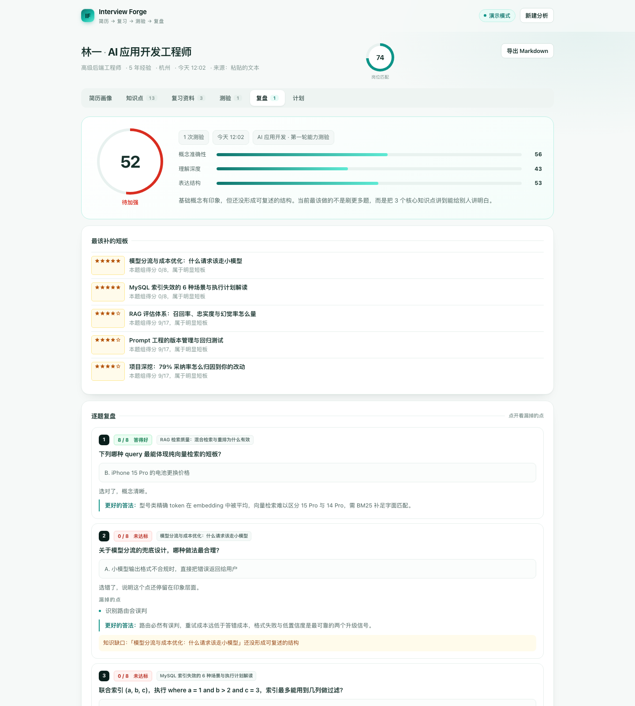

<div align="center">

# Interview Forge

**简历驱动的 AI 面试复习教练**

上传简历 → 拆出你真正会被问到的知识点 → 生成面试官视角的复习资料 → 出题测验 → 打分复盘 → 排出 7 天冲刺计划

[](LICENSE)


</div>

---

## 这是什么

市面上大多数"AI 面试题库"是通用的：所有人刷一样的八股。
Interview Forge 反过来——**从你的简历出发**，模拟一个面过上千人的面试官会怎么审你这份简历：

- 你简历里写的每个技术点，都可能被深挖；
- 你没写但目标岗位需要的，是隐藏考察项；
- 你写的数字（性能提升、降本、增长），一定会被追问归因。

然后把这个面试官的"内部评审笔记"变成你的复习资料：能直接开口说的答题框架、连环追问的应答、埋坑提示，最后用一套测验验证你是"背过"还是"真懂"，按短板排出 7 天计划。

**不挑岗位**：技术研发、算法、产品、运营、市场……模型会按岗位的真实面试方式调整考察角度和题型。

## 截图

| 首页 | 知识点图谱 |
| --- | --- |
|  |  |

| 面试官视角复习资料 | 测验复盘 |
| --- | --- |
|  |  |

## 核心特性

- **简历结构化解析**：人物画像、技能盘点（带简历原话佐证）、经历时间线、面试官会质疑的风险点（跳槽频率、成果归因、深度存疑……）
- **知识点图谱**：14-20 个知识点，分 3-5 组，带难度 / 重要度 / 追问预判；自动标注"简历缺口"（岗位需要但你没写的）
- **知识点拓展（AI 关联生成）**：围绕任意知识点一键向外拓展——同族变体、上下游原理、组合考察、岗位延伸，越用越全；可选接入联网检索，让拓展和资料基于真实世界的最新资料
- **面试官视角复习资料**：一句话本质 → 必须记住的结论 → 原理讲透 → 简历入口 → 可背诵的答题框架 → 连环追问与坑 → 易错点 → 加分项 → 自测题
- **测验与打分**：单选 + 简答 + 场景设计，按评分点给部分分，逐题给出"更好的答法"（可直接背）
- **复盘与推荐**：三维评分（概念 / 深度 / 表达）、薄弱知识点、7 天可执行计划（每天 2-3 个任务，强制安排开口练）
- **一键导出**：整份复习手册导出 Markdown，或直接打印成 PDF
- **演示模式**：`npm run demo` 不需要任何 API Key，用内置样例数据跑通全流程
- **隐私友好**：简历和所有数据只存在你自己的机器上（一个 JSON 文件），不经过任何第三方

## 快速开始

```bash
git clone https://github.com/<your-name>/interview-forge.git
cd interview-forge
npm install

# 方式一：先看看长什么样（无需 API Key）
npm run demo

# 方式二：正式使用
cp .env.example .env     # 填入 LLM_API_KEY
npm start
```

打开 <http://localhost:8787>，上传简历（PDF / DOCX / TXT / MD）或直接粘贴文本。

## 模型配置

任何 **OpenAI 兼容接口**都能用，改 `.env` 里的三个变量即可：

| 提供商 | LLM_BASE_URL | 模型示例 |
| --- | --- | --- |
| OpenAI | `https://api.openai.com/v1` | `gpt-4o-mini` |
| DeepSeek | `https://api.deepseek.com/v1` | `deepseek-chat` |
| 月之暗面 | `https://api.moonshot.cn/v1` | `moonshot-v1-32k` |
| 阿里百炼 | `https://dashscope.aliyuncs.com/compatible-mode/v1` | `qwen-plus` |
| 智谱 | `https://open.bigmodel.cn/api/paas/v4` | `glm-4-plus` |
| 本地 Ollama | `http://127.0.0.1:11434/v1` | `qwen2.5:14b`（Key 随便填） |

> 推理类模型（如 o 系列、R1）可能不遵守 JSON 输出，建议用常规 chat 模型。

## 环境变量

| 变量 | 默认值 | 说明 |
| --- | --- | --- |
| `LLM_BASE_URL` | `https://api.openai.com/v1` | OpenAI 兼容接口地址 |
| `LLM_API_KEY` | — | API Key |
| `LLM_MODEL` | `gpt-4o-mini` | 模型名 |
| `LLM_TEMPERATURE` | `0.4` | 生成温度 |
| `LLM_MAX_TOKENS` | `4096` | 单次回复上限，资料类建议 ≥ 3000 |
| `LLM_TIMEOUT_MS` | `120000` | 单次请求超时 |
| `SEARCH_PROVIDER` | `tavily` | 可选。检索服务商：`tavily` / `bocha` / `brave` / `serper` / `searxng` / `custom` |
| `SEARCH_API_KEY` | — | 可选。检索 Key。配置后拓展知识点 / 生成资料会先检索真实资料注入给模型；`searxng` 自建实例不需要 |
| `SEARCH_ENDPOINT` | 按 provider 取默认 | 自定义检索地址（自建 searxng、私有网关时用） |
| `PORT` | `8787` | 服务端口 |
| `DATA_DIR` | `./data` | 数据目录（JSON 文件） |
| `DEMO_MODE` | `0` | `1` 时不调用模型，用内置样例数据 |

## Docker 部署

```bash
docker compose up -d
# 或手动构建
docker build -t interview-forge .
docker run -p 8787:8787 -v ./data:/app/data --env-file .env interview-forge
```

## 项目结构

```
interview-forge/
├── server/
│   ├── index.js      # Express 路由与静态资源
│   ├── pipeline.js   # 六段生成流水线（解析→知识点→资料→测验→复盘→拓展→计划）
│   ├── prompts.js    # 全部提示词（产品的"大脑"，欢迎 PR 调优）
│   ├── llm.js        # OpenAI 兼容客户端：重试 / JSON 修复 / 超时
│   ├── search.js     # 可选联网检索增强（多家服务商可切换，不绑定 Tavily）
│   ├── mock.js       # 演示模式样例数据
│   ├── extract.js    # PDF / DOCX / TXT 文本抽取
│   ├── jobs.js       # 内存任务队列 + 进度上报
│   ├── store.js      # JSON 文件存储（原子写入）
│   └── export.js     # 整份手册导出 Markdown
├── public/           # 零依赖原生 JS 前端（无构建步骤）
├── samples/          # 示例简历
└── scripts/e2e.mjs   # 端到端自测（配合 npm run demo 使用）
```

## 工作原理

```
简历(PDF/DOCX/文本)
   │  文本抽取 + 清洗
   ▼
① 结构化解析 ──→ 画像 / 技能 / 经历 / 风险点
   ▼
② 知识点推导 ──→ 简历深挖(60%) + 岗位必考(25%) + 简历缺口(15%)
   ▼
③ 复习资料 ───→ 按知识点逐个生成（并发 2，失败单独标记不影响整体）
   ▼
④ 测验 ──────→ 单选 / 简答 / 场景设计，带评分点（rubric）
   ▼
⑤ 批改复盘 ──→ 部分分评分 + 三维能力分 + 知识缺口
   ▼
⑥ 7 天计划 ──→ 按短板与出现概率排序，含开口练任务

随时可插入的一步：
   任意知识点 ──→ ⑦ AI 拓展 ──→ 同族变体 / 上下游 / 组合考察 / 岗位延伸
                    （可选：先联网检索相关知识再生成，可反复触发）
```

提示词设计原则（详见 `server/prompts.js`）：

1. 人设固定为资深面试官，输出像内部评审笔记，不像百科；
2. 所有结论必须能回溯到简历原文，禁止泛泛而谈；
3. 严格 JSON 输出 + 自动修复重试，前端直接渲染；
4. 参考资料只允许写真实存在的经典书 / 官方文档，不确定就留空，**禁止编造**。

## 自测

```bash
npm run demo &        # 启动演示模式
node scripts/e2e.mjs  # 跑完整闭环：上传→资料→测验→批改→计划→导出
```

CI 会在 Node 20 / 22 上自动执行以上流程。

## FAQ

**Q：扫描版 / 图片版 PDF 能用吗？**
不能。文本抽取依赖 PDF 内嵌文字层，扫描件会解析失败，请改传 DOCX 或直接粘贴文本。

**Q：数据存在哪？会传到别处吗？**
只存在你部署机器的 `data/db.json` 一个文件里。简历内容只会发给你自己配置的大模型服务商。删除记录即物理删除。

**Q：和"AI 面试题库"有什么区别？**
题库是题目的集合；这是围绕"你这份简历会被怎么审"生成的复习系统——知识点、资料、题目、复盘全部由你的简历和目标岗位动态生成。

**Q：必须配 Tavily 才能联网吗？**
不需要，也完全可以不联网。`SEARCH_PROVIDER` 支持 `tavily` / `bocha` / `brave` / `serper` / `searxng` / `custom` 六种，配任意一家即可；一个都不配也能跑完整流程，只是知识点和资料完全基于模型自身知识（计算机基础、系统设计这类变化慢的内容影响很小，最新框架/岗位行情才有差距）。
国内网络建议用 `bocha`（直连、中文好）或自建 `searxng`（免费）；`tavily` 是默认值，胜在结果已经清洗成适合喂模型的正文片段。

**Q：支持多用户吗？**
当前版本面向个人自托管（无账号体系），适合自己用或团队内部部署一个实例。多用户支持在 Roadmap 里。

## Roadmap

- [ ] 流式输出（资料生成进度可视化到段落级）
- [ ] 面试官追问模拟（多轮对话式模拟面试）
- [ ] 多用户与账号体系
- [ ] 简历优化建议（反向输出：简历怎么改）
- [ ] SQLite 存储后端可选
- [ ] 英文简历 / 英文面试支持

## 贡献

欢迎 PR，尤其是：

- `server/prompts.js` 的提示词调优（对比效果，附截图更好）
- 新岗位类型的考察策略
- 非中文语言支持

```bash
npm install
npm run dev      # 开发模式（文件变动自动重启）
```

## License

[MIT](LICENSE)
