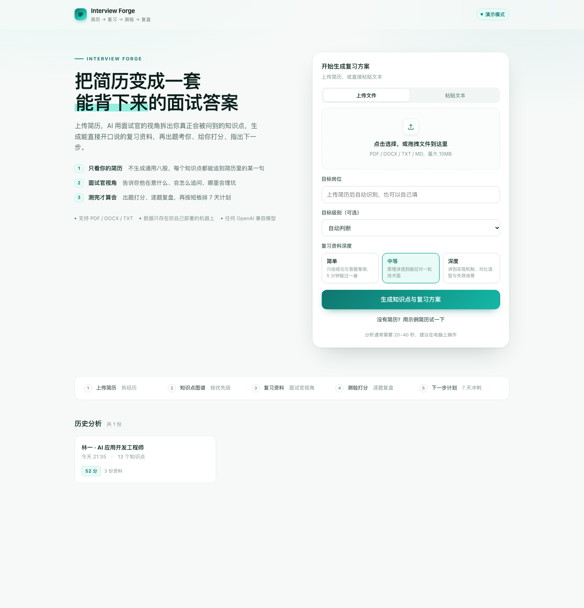
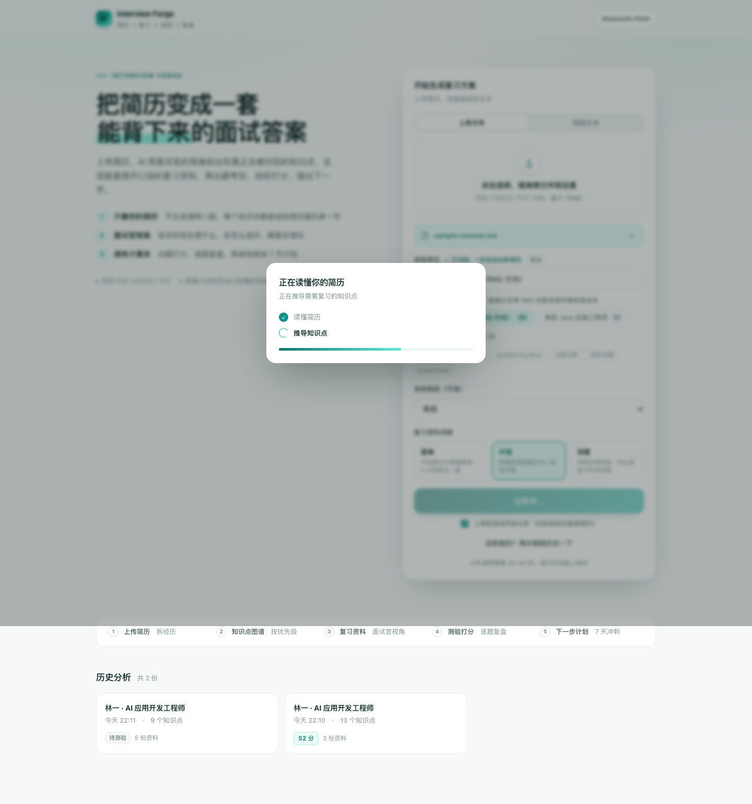
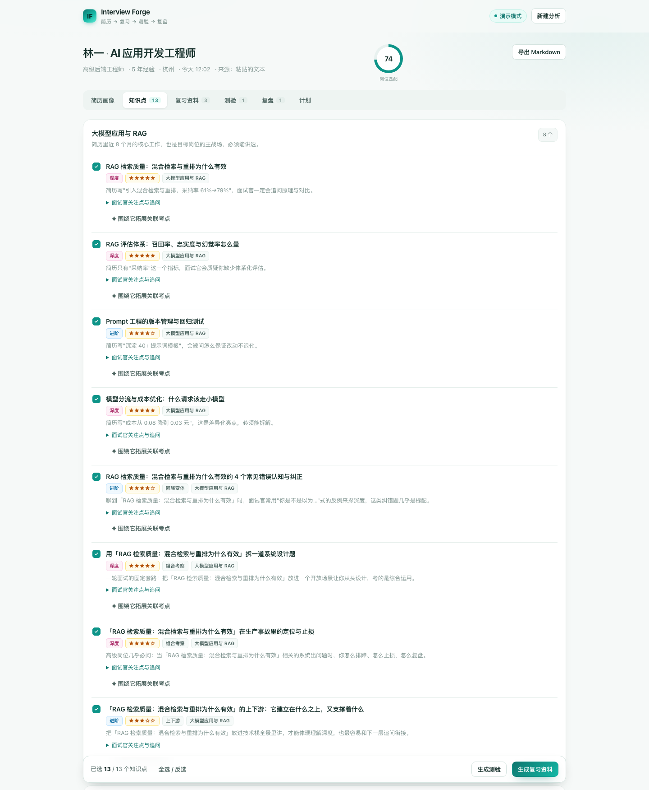
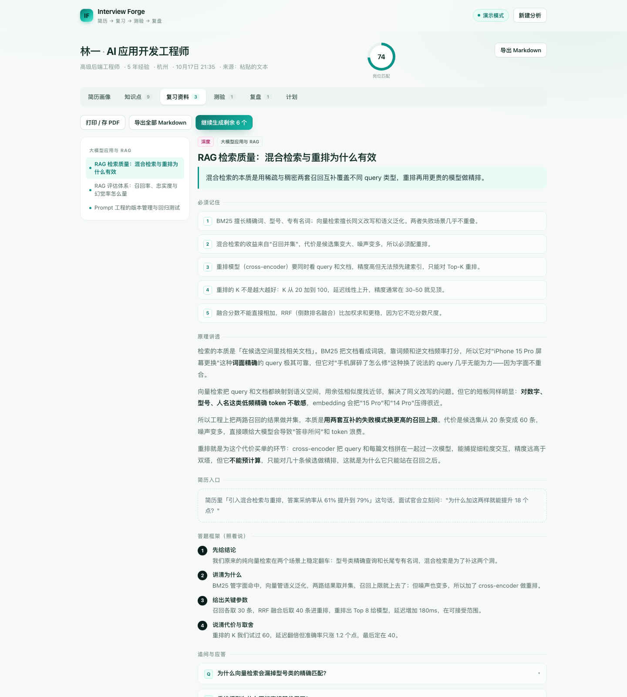
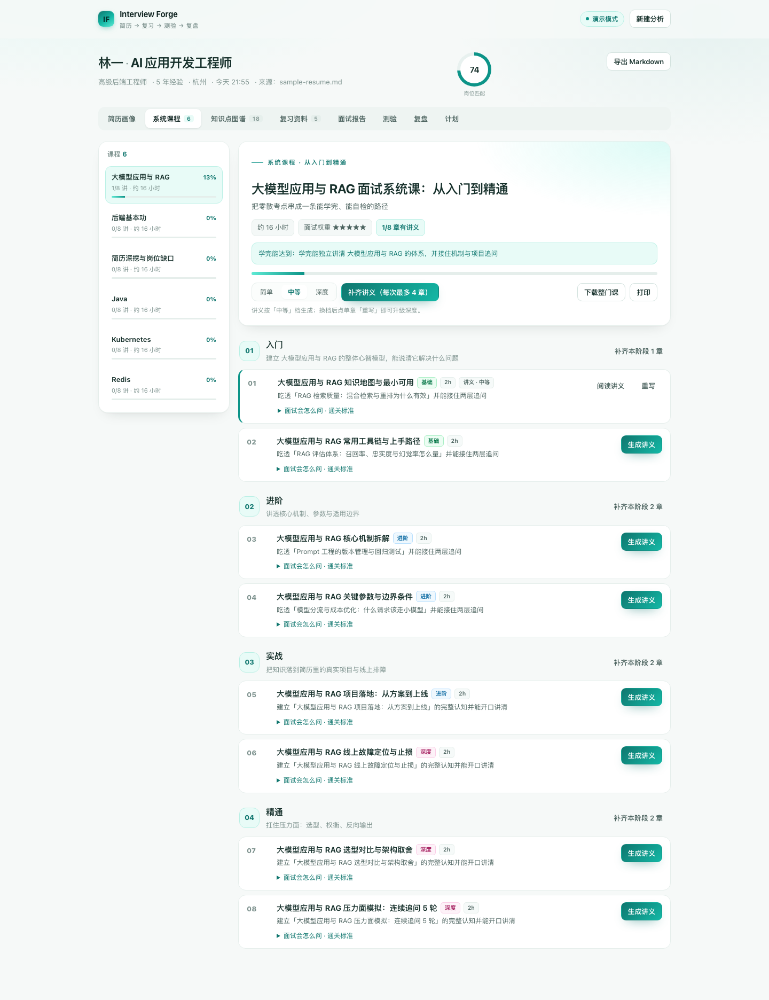
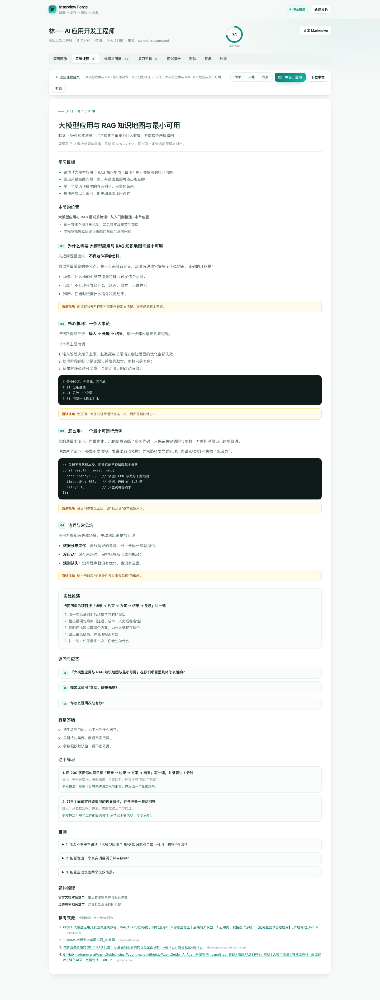
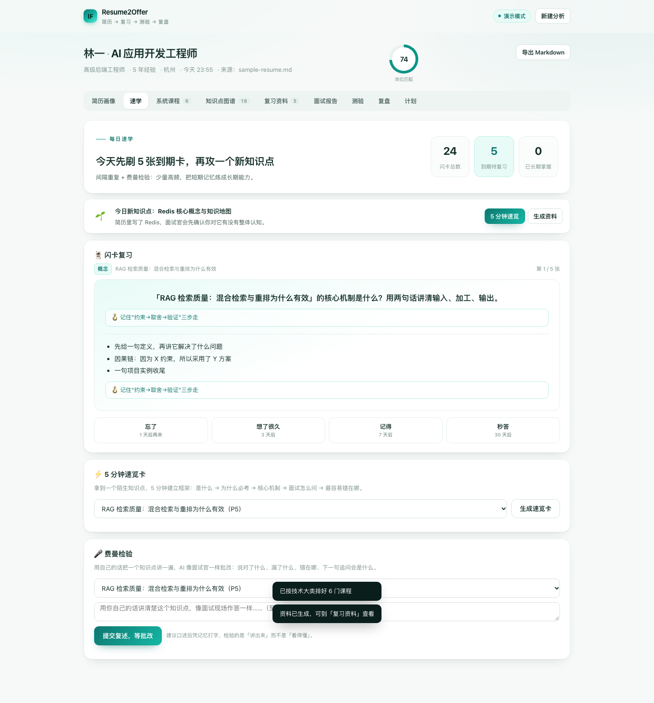
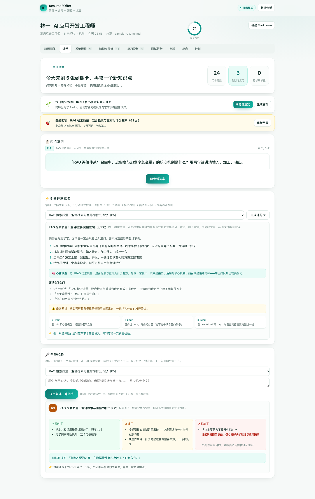

<div align="center">

# Resume2Offer

**答案不在题库里，在你的简历里。**

[English](README.en.md) | 中文

简历驱动的 AI 面试复习教练 · 上传简历 → 拆出你真正会被问到的知识点 → 每类技术一门从入门到精通的系统课 → 生成面试官视角的复习资料 → 出题测验 → 打分复盘 → 排出 7 天冲刺计划

[](LICENSE)


</div>

---

## 这是什么

市面上大多数「AI 面试题库」是通用的：所有人刷一样的八股。
Resume2Offer 反过来——**从你的简历出发**，模拟一个面过上千人的面试官会怎么审你这份简历：

- 你简历里写的每个技术点，都可能被深挖；
- 你没写但目标岗位需要的，是隐藏考察项；
- 你写的数字（性能提升、降本、增长），一定会被追问归因。

然后把这个面试官的「内部评审笔记」变成你的复习资料：能直接开口说的答题框架、连环追问的应答、埋坑提示，最后用一套测验验证你是「背过」还是「真懂」，按短板排出 7 天计划。

**不挑岗位**：技术研发、算法、产品、运营、市场……模型会按岗位的真实面试方式调整考察角度和题型。

## 截图

| 首页（上传即识别岗位） | 简历画像（拆解结果） |
| --- | --- |
|  |  |

| 知识点图谱 + 优先级模块 | 三档深度复习资料（带引用来源） |
| --- | --- |
|  |  |

| 系统课程（每类技术一门课） | 章节讲义（结构化阅读） |
| --- | --- |
|  |  |

| 速学中心：闪卡复习（遗忘曲线） | 费曼检验（AI 批改复述） |
| --- | --- |
|  |  |

## 核心特性

### 先读懂你这份简历

- **上传即识别岗位，识别完自动开拆**：简历一上传（或粘贴），AI 立即推断 2-3 个最该投的岗位与级别，自动填充输入框；默认 3 秒后自动开始完整分析（可在表单里关闭，或点「取消」），分析完先落在「简历画像」页看拆解结果，资料在后台继续生成
- **简历结构化解析**：识别概览（技能 / 经历 / 项目 / 风险点 / 考点计数）+ 人物画像、技能盘点（带简历原话佐证）、经历时间线、面试官会质疑的风险点
- **知识图谱**：SVG 可视化——岗位 → 分组 → 考点三层树状图，节点按重要度着色、虚线标注「简历缺口」、已有资料实时点亮；下方是**按优先级排序的学习模块清单**，每个模块可单独点「生成资料」
- **技能覆盖保证**：解析时会穷举简历里的所有技术大类（Java / Android / Docker / K8s……），并强制每个大类至少落进一组考点——模型「挑重点」漏了整类也没关系，缺失会自动补齐或兜底建组；画像页的「技能覆盖」卡能一眼核对，点任意技能直达对应课程

### 系统课程：每个技术大类一门「从入门到精通」

散装的考点卡只适合速查，系统性复习需要课程。Resume2Offer 会为简历里的**每个技术大类单独排一门课**（Java 一门、Kubernetes 一门……）：

- **4 阶段 20-24 章**：入门（心智模型与最小可用）→ 进阶（原理、参数取舍、边界与坑）→ 实战（绑你简历里的项目、线上排障、压测与变更）→ 精通（源码/内核、选型对比、压力面连环追问）。每阶段 5-6 章，铺满该阶段该管的面试面，不用两三章草草带过
- **每章都有结构**：学习目标、先修章节、面试会怎么问、预计时长、可自检的通关标准
- **章节讲义**：分节讲解 + 可运行代码/命令 + 完整实战推演 + 追问应答（带埋坑提示）+ 易错点 + 动手练习 + 自测题；同样支持简单 / 中等 / 深度三档、历史版本
- **复用考点**：排课时优先复用已生成的考点（速查卡要点会注入讲义生成上下文），两套内容互相衔接而不是重复劳动
- **考点覆盖是硬约束**：排完课会用代码校验「这个技术大类的每个考点是否真的落在某一章里」——能对上就挂上去，对不上就补一章，课程页直接显示 `考点覆盖 9/9`，不靠模型自觉
- **进度管理**：每门课有章节进度条，可单章生成、按阶段补齐、一键补满（每次最多 4 章），整门课 / 单章都可下载 Markdown 或打印

### 速学中心：把「看过」变成「记得住、讲得出」

看懂 ≠ 记住，记住 ≠ 讲得出。速学中心用三条经过验证的学习科学方法补上这一环：

- **闪卡 + 遗忘曲线**：把知识点自动做成问答闪卡（正面是面试官的问法，背面是采分点 + 记忆钩子），按简化 SM-2 间隔（1 / 3 / 7 / 15 / 30 天）安排复习。翻卡自评四档：忘了 / 想了很久 / 记得 / 秒答——忘了重来，秒答拉长间隔
- **5 分钟速览卡**：对任意陌生知识点一键生成一页纸：一句话说清是什么 → 为什么必考 → 核心要点 → 一个好记的心智模型 → 面试怎么问 → 最容易错在哪，还附 0-1-3-5 分钟的阅读路径
- **费曼检验**：用自己的话把知识点复述一遍，AI 像面试官一样批改——说对了什么、漏了哪些采分点、哪里说错了（原话对照 + 正确说法）、面试官下一句追问会是什么
- **每日速学**：打开速学页就知道今天干什么——几张到期卡、优先攻哪个新知识点、上次费曼没过 70 分的弱项提醒，不用自己安排

### 再生成你真正要背的资料

- **资料三档深度**：简单 / 中等 / 深度随选。简单档只给能立刻背走的要点，深度档写到实现机制、选型对比和压力面话术；切换深度可对任意单篇重写
- **全网检索 + 引用来源**：配置检索服务商后，生成资料与报告前先抓取真实网页内容注入模型，来源以可点击链接标注在资料底部，正文带 `[1][2]` 引用编号
- **按需生成**：分析完成自动生成优先级最高的 5 篇资料，其余模块点一下「生成资料」再出，不浪费额度
- **知识点拓展（AI 关联生成）**：围绕任意知识点一键向外拓展——同族变体、上下游原理、组合考察、岗位延伸，越用越全
- **AI 随问（划词追问）**：阅读资料 / 课程讲义 / 报告时，选中任意一段内容就会浮出「问 AI」按钮，点击后在右下角弹出对话框，AI 结合你的简历与目标岗位把这段内容讲清楚（核心、为什么重要、面试怎么问、易错点）；可继续在对话框里多轮追问，对话按分析记录自动保存
- **历史版本**：同一知识点重写不会覆盖旧内容，旧版本自动存档，可随时查看与单独下载

### 最后验证你学会了没有

- **面试准备报告**：一键汇总成判断——能不能过、致命短板、模块优先级、分阶段学习路径、各轮面试预演，附全部引用来源，可下载 Markdown
- **测验与打分**：单选 + 简答 + 场景设计，按评分点给部分分，逐题给出「更好的答法」（可直接背）
- **复盘与推荐**：三维评分（概念 / 深度 / 表达）、薄弱知识点、7 天可执行计划（每天 2-3 个任务，强制安排开口练）

### 工程与隐私

- **下载学习**：单篇资料 / 单章讲义 / 整门课程 / 面试报告 / 整份复习手册都可导出 Markdown，或直接打印成 PDF；所有生成记录（含历史版本）都保存在本地
- **演示模式**：`npm run demo` 不需要任何 API Key，用内置样例数据跑通全流程
- **隐私友好**：简历和所有数据只存在你自己的机器上（一个 `data/db.json`），不经过任何第三方；简历正文只会发给你自己配置的模型服务商
- **零构建前端**：原生 JS，无框架、无打包步骤，改完刷新即生效

## 快速开始

需要 **Node.js ≥ 20**。

```bash
git clone https://github.com/<your-name>/resume2offer.git
cd resume2offer
npm install

# 方式一：先看看长什么样（无需 API Key）
npm run demo

# 方式二：正式使用
cp .env.example .env     # 填入 LLM_API_KEY
npm start
```

打开 <http://localhost:8787>，上传简历（PDF / DOCX / TXT / MD，≤10MB）或直接粘贴文本。上传后岗位会自动识别填充，随后自动开始分析（可关闭）。

> 8787 被别的程序占了？换一行即可：`PORT=8899 npm start`（或写进 `.env`）。本服务启动时会自检这个端口，如果 `127.0.0.1` 上响应的不是自己，会直接打印占用进程的排查命令。
>
> **更新代码后页面还是旧的？** 入口 HTML 已设置为不缓存，静态资源引用带内容版本号（`app.js?v=xxx`），正常刷新即可拿到最新前端；无需手动清缓存。

## 模型配置

任何 **OpenAI 兼容接口**都能用，改 `.env` 里的三个变量即可：

| 提供商 | LLM_BASE_URL | 模型示例 |
| --- | --- | --- |
| OpenAI | `https://api.openai.com/v1` | `gpt-4o-mini` |
| DeepSeek | `https://api.deepseek.com/v1` | `deepseek-chat` |
| 月之暗面 | `https://api.moonshot.cn/v1` | `moonshot-v1-32k` |
| 阿里百炼 | `https://dashscope.aliyuncs.com/compatible-mode/v1` | `qwen-plus` |
| 智谱 | `https://open.bigmodel.cn/api/paas/v4` | `glm-4-plus` |
| 本地 Ollama | `http://127.0.0.1:11434/v1` | `qwen2.5:14b`（Key 随便填） |

> **推理型模型也能用了**（`deepseek-flash`、o 系列等）：这类模型先「思考」再回答，思考同样占 `max_tokens`，容易把 JSON 截断。程序会识别截断并自动翻倍重试，同时修复裸换行、尾逗号等脏 JSON。想更快更省，建议 `LLM_REASONING_EFFORT=low`；日常使用仍推荐常规 chat 模型（如 `deepseek-chat`）。

## 联网检索（可选）

不配任何检索服务也**能跑完整流程**，只是资料完全基于模型自身知识。配上之后，生成资料 / 报告 / 拓展知识点前会先检索真实网页，内容更新、更全，并带上引用来源。

`SEARCH_PROVIDER` 任选一家，不绑定任何厂商：

| provider | 地址 | 说明 |
| --- | --- | --- |
| `tavily` | <https://tavily.com> | 默认。免费 1000 次/月，结果已清洗成适合喂模型的正文片段 |
| `bocha` | <https://bochaai.com> | 国内直连、中文资料质量好，按量付费 |
| `brave` | <https://brave.com/search/api> | 独立索引，免费额度需绑卡 |
| `serper` | <https://serper.dev> | Google 结果，便宜、量大 |
| `searxng` | 自建 | 完全免费，`SEARCH_ENDPOINT` 填自己的实例（如 `http://127.0.0.1:8080/search`） |
| `custom` | 自定 | 任意 Tavily 兼容接口，`SEARCH_ENDPOINT` 指向它 |

检索失败会自动降级为空结果，不会阻断生成流程。

## 环境变量

| 变量 | 默认值 | 说明 |
| --- | --- | --- |
| `LLM_BASE_URL` | `https://api.openai.com/v1` | OpenAI 兼容接口地址 |
| `LLM_API_KEY` | — | API Key |
| `LLM_MODEL` | `gpt-4o-mini` | 模型名 |
| `LLM_TEMPERATURE` | `0.4` | 生成温度 |
| `LLM_MAX_TOKENS` | `8192` | 单次回复上限。推理型模型思考也占 token，给小了 JSON 会被截断（程序会自动升配重试） |
| `LLM_REASONING_EFFORT` | 空 | 推理强度 `low` / `high` / `max`，仅推理型模型支持。填 `low` 更快更省、更少截断；留空则不发送 |
| `LLM_TIMEOUT_MS` | `180000` | 单次请求超时。推理模型首字很慢，建议别低于 180 秒 |
| `SEARCH_PROVIDER` | `tavily` | 可选。检索服务商：`tavily` / `bocha` / `brave` / `serper` / `searxng` / `custom` |
| `SEARCH_API_KEY` | — | 可选。检索 Key；`searxng` 自建实例不需要 |
| `SEARCH_ENDPOINT` | 按 provider 取默认 | 自定义检索地址（自建 searxng、私有网关时用） |
| `SEARCH_TIMEOUT_MS` | `15000` | 单次检索超时，超时即降级 |
| `PORT` | `8787` | 服务端口 |
| `HOST` | `0.0.0.0` | 监听地址。只想本机访问可设为 `127.0.0.1` |
| `DATA_DIR` | `./data` | 数据目录（JSON 文件，无需数据库） |
| `DEMO_MODE` | `0` | `1` 时不调用模型，用内置样例数据 |

## Docker 部署

```bash
docker compose up -d
# 或手动构建
docker build -t resume2offer .
docker run -p 8787:8787 -v ./data:/app/data --env-file .env resume2offer
```

镜像自带 `HEALTHCHECK`，数据挂载在 `/app/data`，重启不丢历史记录。

## 项目结构

```
resume2offer/
├── server/
│   ├── index.js      # Express 路由、静态资源版本号、端口自检
│   ├── config.js     # 环境变量收敛与默认值
│   ├── pipeline.js   # 生成流水线（预判→解析→知识点→资料→课程→讲义→报告→测验→批改→计划→拓展）
│   ├── prompts.js    # 全部提示词 + 三档深度规格（产品的"大脑"，欢迎 PR 调优）
│   ├── llm.js        # OpenAI 兼容客户端：截断升配重试 / JSON 修复 / 超时
│   ├── search.js     # 可插拔联网检索（六家服务商，统一归一化，失败降级）
│   ├── coverage.js   # 技能覆盖校验：归一化 / 别名匹配 / 缺失补齐 / 兜底建组
│   ├── mock.js       # 演示模式样例数据
│   ├── extract.js    # PDF / DOCX / TXT 文本抽取
│   ├── filename.js   # 中文文件名编码还原（latin1 → UTF-8）
│   ├── jobs.js       # 内存任务队列 + 进度上报
│   ├── store.js      # JSON 文件存储（原子写入，启动自愈存量数据）
│   └── export.js     # 单篇资料 / 面试报告 / 整份手册导出 Markdown
├── public/           # 零依赖原生 JS 前端（无构建步骤）
├── samples/          # 示例简历
├── scripts/
│   ├── e2e.mjs           # 端到端全链路自测
│   ├── coverage.mjs      # 技能覆盖校验自测（别名 / 缺失 / 兜底）
│   ├── search-adapters.mjs # 六家检索适配器解析 + 降级自测
│   ├── llm-guard.mjs     # 截断升配 / 空正文 / 脏 JSON 自测
│   └── filename.mjs      # 中文文件名还原自测
└── .github/workflows/ci.yml
```

## 工作原理

```
简历(PDF/DOCX/文本)
   │  文本抽取 + 清洗
   ▼
⓪ 岗位预判 ───→ 上传即推断 2-3 个该投的岗位，自动填充（可改）
   ▼
① 结构化解析 ──→ 画像 / 技能 / 经历 / 风险点（页面直接展示识别结果）
   │              └→ 技能栈穷举 + 覆盖校验（缺类自动补齐 / 兜底建组）
   ▼
② 知识点推导 ──→ 简历深挖(60%) + 岗位必考(25%) + 简历缺口(15%)
   │              └→ SVG 知识图谱 + 按优先级排序的学习模块
   ▼
②.5 系统课程 ──→ 每个技术大类一门课：入门→进阶→实战→精通（4 阶段 20-24 章）
   │              分析完自动排优先级最高的课，其余点击排课；章节讲义按需生成
   ▼
③ 复习资料 ───→ 自动生成优先级最高的 5 篇，其余点击生成
   │              深度三档（简单/中等/深度），切档重写，历史版本保留
   │              （可选：先全网检索，来源以链接+编号标注）
   ▼
④ 面试报告 ──→ 总体判断 / 致命短板 / 模块优先级 / 分阶段路径 / 各轮预演
   ▼
⑤ 测验 ──────→ 单选 / 简答 / 场景设计，带评分点（rubric）
   ▼
⑥ 批改复盘 ──→ 部分分评分 + 三维能力分 + 知识缺口
   ▼
⑦ 7 天计划 ──→ 按短板与出现概率排序，含开口练任务

随时可插入的一步：
   任意知识点 ──→ ⑧ AI 拓展 ──→ 同族变体 / 上下游 / 组合考察 / 岗位延伸
```

课程与讲义的新增接口：

| 方法 | 路径 | 说明 |
| --- | --- | --- |
| POST | `/api/analyses/:id/courses` | 按技术大类排课；`{auto:true}` 取优先级前几门，`{names:[...]}` 指定大类 |
| POST | `/api/analyses/:id/courses/:cid/lessons` | 生成章节讲义 `{chapterIds, depth}`，并发 2 |
| GET | `/api/analyses/:id/courses/:cid.md` | 导出整门课（大纲 + 已生成讲义） |
| GET | `/api/analyses/:id/courses/:cid/chapters/:chid.md` | 导出单章讲义 |
| POST | `/api/chat` | AI 随问：`{analysisId?, selection?, context?, messages}` 多轮对话，直接响应不进队列 |
| POST | `/api/analyses/:id/mock/start` | 模拟面试开场：`{mode: standard\|pressure}`，面试官抛第一个问题 |
| POST | `/api/analyses/:id/mock/turn` | 回答一题：`{sessionId, answer}`，面试官追问下一题，直接响应 |
| POST | `/api/analyses/:id/mock/finish` | 收尾出评分报告（任务） |
| POST | `/api/analyses/:id/jd` | JD 对比：`{jdText}`，逐条对照简历输出匹配 / 缺口 / 行动 |
| POST | `/api/analyses/:id/resume-review` | 简历评审：面试官视角的追问预演 + 改写建议 |
| POST | `/api/analyses/:id/progress` | 章节学习进度：`{chapterId, status: none\|learned\|mastered}` |
| GET | `/api/usage` | 本服务累计 LLM token 用量 |

速学中心的接口：

| 方法 | 路径 | 说明 |
| --- | --- | --- |
| POST | `/api/analyses/:id/flashcards` | 批量生成闪卡 `{count, topicIds?}`（任务） |
| POST | `/api/analyses/:id/flashcards/:cid/review` | 翻卡自评 `{grade: 0-3}`，直接响应并更新复习计划 |
| POST | `/api/analyses/:id/quickcard` | 生成 5 分钟速览卡 `{topicId}`（任务） |
| POST | `/api/analyses/:id/feynman` | 费曼检验 `{topicId, explanation}`（任务） |
| GET | `/api/analyses/:id/daily` | 每日速学：到期卡 / 新知识点 / 费曼弱项，直接计算 |

提示词设计原则（详见 `server/prompts.js`）：

1. 人设固定为资深面试官，输出像内部评审笔记，不像百科；
2. 所有结论必须能回溯到简历原文，禁止泛泛而谈；
3. 严格 JSON 输出 + 自动修复重试，前端直接渲染；
4. 参考资料只允许写真实存在的经典书 / 官方文档，不确定就留空，**禁止编造**。

## 自测

```bash
npm test                 # 四组离线自测：文件名编码 / 技能覆盖 / 模型输出健壮性 / 检索适配器
npm run check            # 语法检查

npm run demo &           # 启动演示模式（无需 Key）
node scripts/e2e.mjs     # 端到端：预判→解析→覆盖校验→三档资料→版本→下载→出题→批改→拓展→计划→报告→课程→讲义→导出
```

| 脚本 | 覆盖内容 | 需要联网 / Key |
| --- | --- | --- |
| `scripts/filename.mjs` | 中文名、latin1 乱码名、纯 ASCII、带重音字符等 6 个用例 | 否 |
| `scripts/coverage.mjs` | 别名匹配（K8s↔Kubernetes）、缺失判定、兜底建组等 13 个用例 | 否 |
| `scripts/llm-guard.mjs` | 截断自动升配、推理吃光正文、裸换行 / 尾逗号修复 | 否（用桩模型） |
| `scripts/search-adapters.mjs` | 六家服务商请求与结果归一化、失败降级 | 否（本地桩服务） |
| `scripts/e2e.mjs` | 完整业务闭环 + 课程链路 + 记录结构 | 否（demo 模式） |

CI 在 Node 20 / 22 上执行：语法检查 → 四组离线自测 → 启动 demo → 端到端全链路。

## 更新日志

**2026-10-24 — 模拟面试 / JD 对比 / 简历评审 / 学习进度 / 用量 / 备份 / 鉴权**

- 新增「模拟面试」Tab：AI 面试官按简历和考点连续追问 8-10 题（项目深挖 → 原理 → 排障 → 系统设计），一次只问一个问题，答完出面试官视角评分报告（总分 + 分维度 + 没接住的追问 + 7 天练习建议）；支持标准 / 压力面两种模式，会话自动落库保留最近 5 场
- 画像页新增「JD 对比」：粘贴真实 JD，逐条对照简历输出扛得住的 / 缺口（按严重度）/ 面试前优先动作 / 缺口话术
- 画像页新增「简历评审」：逐行模拟"这一条我会怎么追问"，给出改写前后的句子和可直接删掉的内容
- 模拟面试报告新增**逐题参考答案**：每道题给出面试官出题意图、现场回答点评、详细参考答案（30 秒答题框架 + 原理展开 + 结合简历的例子 + 避坑提醒）和 1-3 个连环追问及应对
- 模拟面试支持语音输入：浏览器原生识别（Edge / Safari 开箱即用，Chrome 依赖的网络通道国内可能不通），说完自动转文字进输入框，不需要任何第三方服务
- 系统课程章节支持学习进度标记（未学 → 已学 → 已掌握，点击章节行末按钮切换），课程页显示掌握统计
- 顶栏新增 LLM token 用量统计（`/api/usage`，累计落盘到 `data/usage.json`）
- 数据安全：每次写入前对 `db.json` 做节流快照到 `data/backups/`（默认保留 10 份）；新增可选 `ACCESS_TOKEN` 访问鉴权（设置后所有 API 需带令牌，前端自动引导输入）
- 重排大纲时旧讲义不再直接丢弃，无同名章节的旧讲义归档进 `course.orphanLessons`
- 开源基建：Issue/PR 模板、`CONTRIBUTING.md`、英文版 `README.en.md`

**2026-10-22c — 考点覆盖硬校验**

- 新增 `topicCoverage()` / `attachUncoveredTopics()`：排课后逐一核对「本组考点是否出现在某章的 `topicIds` 里」，相似度高的挂到最相关章节，找不到对应章节就补一章（放到入门/进阶/精通对应阶段，带上面试问法），保证覆盖率 100%
- 课程页新增 `考点覆盖 x/y` 徽标（未全覆盖时为警示色，悬停显示漏掉的考点标题），侧栏「待排课」新增「全部排课」一键入口
- 实测：RAG 组 9 个考点从旧版 12 章命中 5 个，重排后 23 章命中 9/9

**2026-10-22b — 系统课程加厚到 20-24 章**

- 排课标准从「每阶段 2-4 章、全书 8-14 章」提到 **每阶段 5-6 章、全书 20-24 章**，并把阶段分工写死成四类面试面：入门（心智模型 / 环境 / 最小可用 / 常用 API / 首个项目）、进阶（机制 / 参数取舍 / 性能特征 / 常见误区 / 技术边界）、实战（项目落地 / 线上排障 / 压测监控 / 变更回滚 / 协作规范）、精通（源码机制 / 选型答辩 / 容量天花板 / 压力面连环追问 / 体系表达）
- 新增反注水规则：不许把同一主题拆成「XX（一）」「XX（二）」凑章数，每章必须是一个能被独立追问的话题面；同时要求清单里每个考点至少落到一章的 `topicIds`
- 章节字段保持精炼（why ≤ 40 字、2-3 个面试问法、2 条通关标准），深度仍交给按需生成的讲义；大纲单次输出上限 7000 → 12000 token，过长截断时自动降级成 16 章精简版重试，不让整门课失败
- 课程页新增「重排大纲」：老记录（12 章）可一键按新标准重排，同名章节的讲义自动保留
- 演示模式的内置课程同步为 20 章

**2026-10-22 — 一句话 slogan**

- 确立主张：**答案不在题库里，在你的简历里。** 同步到 README 首屏、页面标题与项目描述

**2026-10-21b — 速学中心**

- 新增「速学」Tab 四件套：**闪卡记忆**（问答卡 + 简化 SM-2 遗忘曲线，1/3/7/15/30 天间隔，四档自评）、**5 分钟速览卡**（一页纸快速搞懂任意知识点）、**费曼检验**（复述知识点，AI 像面试官一样批改对/漏/错 + 下一句追问）、**每日速学**（到期卡 + 新知识点 + 弱项提醒，打开就学）
- 新增接口：`POST /api/analyses/:id/flashcards`、`POST /api/analyses/:id/flashcards/:cid/review`、`POST /api/analyses/:id/quickcard`、`POST /api/analyses/:id/feynman`、`GET /api/analyses/:id/daily`
- 体验修复：分析后后台生成资料改为静默模式，不再把正在浏览其他页面的用户强切到「复习资料」

**2026-10-21 — AI 随问**

- 新增「划词问 AI」：阅读时选中任意内容浮出「问 AI」按钮，右下角弹出对话抽屉，AI 结合简历与目标岗位讲解选中内容，支持多轮追问
- 对话按分析记录自动落库（最近 40 条），重新打开时自动恢复上下文；支持「新话题」清空
- 新增 `POST /api/chat` 接口；演示模式内置随问样例回答

**2026-10-20 — 系统课程**

- 新增「系统课程」：简历里每个技术大类（Java / Docker / K8s……）各排一门从入门到精通的课——4 阶段（入门→进阶→实战→精通）、8-14 章，每章带目标、先修、面试问法、时长、通关标准
- 新增「章节讲义」：分节讲解 + 代码/命令 + 实战推演 + 追问应答 + 练习 + 自测，支持三档深度与历史版本，可下载整门课 / 单章
- 技能覆盖保证：解析时穷举简历技术大类并强制成组，模型漏类时自动补齐或兜底建组；画像页新增「技能覆盖」卡，点技能直达课程
- 知识点预算从 14-20 提到 24-36 个 / 5-8 组，已有考点会注入课程与讲义生成上下文（两套内容衔接不重复）
- 新增 `scripts/coverage.mjs` 自测（13 例），e2e 增加课程链路步骤

**2026-10-19 — 稳定性**

- 修复中文简历上传后「来源：」显示为乱码：`multer` 按 latin1 解码文件名，现统一还原为 UTF-8，历史记录在启动时自动修复
- 修复推理型模型导致的「模型没有返回可解析的 JSON」：识别 `finish_reason=length` 后自动翻倍 `max_tokens` 重试（最多 3 次），并就地修复裸换行、尾逗号
- 修复上传后岗位未填充、简历未拆解：入口 HTML 禁止缓存 + 静态资源带版本号，并补全「识别完成自动分析 / 排队补跑 / 失败可见」闭环
- 启动自检端口：被其他程序抢占时打印占用进程与换端口建议

**2026-10-18 — 大功能**

- 上传即自动识别目标岗位并填充
- 知识图谱（SVG）+ 按岗位优先级的模块清单，可按模块按需生成
- 复习资料三档深度、历史版本、单篇下载
- 全网检索结果注入 + 引用来源标注
- 面试准备报告（判断 / 短板 / 路径 / 预演）+ 报告下载
- 检索不再绑定 Tavily，支持六家服务商自由切换

**2026-10-17 — 首个版本**

- 简历解析 → 知识点 → 资料 → 测验 → 批改 → 计划全流程
- 演示模式、Docker、CI、端到端自测

## FAQ

**Q：扫描版 / 图片版 PDF 能用吗？**
不能。文本抽取依赖 PDF 内嵌文字层，扫描件会解析失败，请改传 DOCX 或直接粘贴文本。

**Q：数据存在哪？会传到别处吗？**
只存在你部署机器的 `data/db.json` 一个文件里。简历内容只会发给你自己配置的大模型服务商。删除记录即物理删除。

**Q：和「AI 面试题库」有什么区别？**
题库是题目的集合；这是围绕「你这份简历会被怎么审」生成的复习系统——知识点、资料、题目、复盘全部由你的简历和目标岗位动态生成。

**Q：启动成功，但打开 localhost:8787 是 404？**
端口被别的程序占了。macOS / Linux 允许两个进程分别绑 `127.0.0.1:8787` 和 `0.0.0.0:8787`，浏览器访问 localhost 会优先命中前者，你看到的就是别人的 404。查占用者：`lsof -nP -iTCP:8787 -sTCP:LISTEN`，然后换端口 `PORT=8899 npm start`，或退出那个程序。新版启动日志会主动提示这种情况。

**Q：必须配 Tavily 才能联网吗？**
不需要，也完全可以不联网。`SEARCH_PROVIDER` 支持 `tavily` / `bocha` / `brave` / `serper` / `searxng` / `custom` 六种，配任意一家即可；一个都不配也能跑完整流程，只是知识点和资料完全基于模型自身知识（计算机基础、系统设计这类变化慢的内容影响很小，最新框架 / 岗位行情才有差距）。
国内网络建议用 `bocha`（直连、中文好）或自建 `searxng`（免费）；`tavily` 是默认值，胜在结果已经清洗成适合喂模型的正文片段。

**Q：报错「模型没有返回可解析的 JSON」怎么办？**
这是模型输出被截断或格式坏掉了，不是你的简历有问题。最常见原因是用了**推理型模型**（如 `deepseek-flash`）：它先「思考」再回答，思考同样消耗 `max_tokens`，额度不够时正文只剩半截 JSON。

现在程序会自动处理：识别出截断后**自动翻倍 `max_tokens` 重试**（最多 3 次），空正文、裸换行、尾逗号也会就地修复，仍失败才报错。想彻底少踩这个坑：
- `.env` 里设 `LLM_REASONING_EFFORT=low`（结构化输出够用，快很多也省很多）
- `LLM_MAX_TOKENS` 不要低于 `8192`
- 一次生成的知识点别太多（可分批生成）

**Q：上传中文文件名的简历，历史记录显示乱码？**
已在 2026-10-19 修复。`multer` 默认按 latin1 解码文件名，现在统一还原为 UTF-8；服务启动时也会自动修正已有记录，无需迁移数据。

**Q：支持多用户吗？**
当前版本面向个人自托管（无账号体系），适合自己用或团队内部部署一个实例。多用户支持在 Roadmap 里。

## Roadmap

- [ ] 流式输出（资料生成进度可视化到段落级）
- [ ] 面试官追问模拟（多轮对话式模拟面试）
- [ ] 多用户与账号体系
- [ ] 简历优化建议（反向输出：简历怎么改）
- [ ] SQLite 存储后端可选
- [ ] 英文简历 / 英文面试支持

## 贡献

欢迎 PR，尤其是：

- `server/prompts.js` 的提示词调优（对比效果，附截图更好）
- 新岗位类型的考察策略
- 非中文语言支持

```bash
npm install
npm run dev      # 开发模式（文件变动自动重启）
npm test         # 提交前跑一遍离线自测
```

## License

[MIT](LICENSE)

---

如果这个项目对你有帮助，点个 Star 就是最好的支持。
